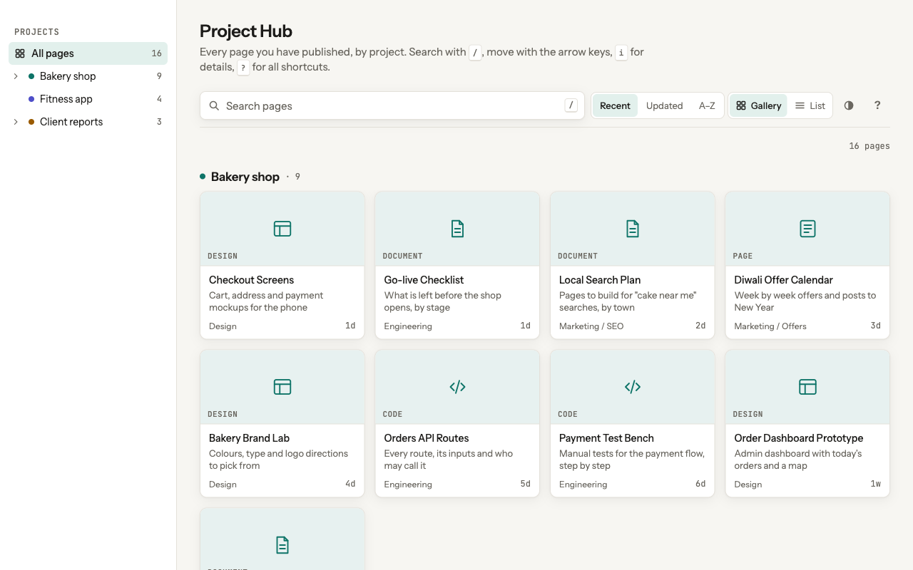
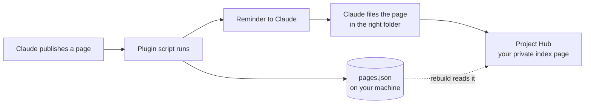

<div align="center">

# Artifact Hub

**Folders for your Claude artifacts.**

Every page you publish from Claude Code is saved to a list on your machine and filed into project folders and subfolders on one index page.

[](https://github.com/SureshKumar-24/artifact-hub/actions/workflows/test.yml)
[](https://github.com/SureshKumar-24/artifact-hub/tags)
[](LICENSE)




<sub>The screenshot shows example pages in the gallery view (1.5.0). Covers are drawn from the title, not screenshots.</sub>

</div>

## Contents

- [Install](#install)
- [The problem](#the-problem)
- [What you get](#what-you-get)
- [How it works](#how-it-works)
- [Using it](#using-it)
- [Folders and subfolders](#folders-and-subfolders)
- [What it runs, reads and sends](#what-it-runs-reads-and-sends)
- [What it costs](#what-it-costs)
- [Limits](#limits)
- [Questions](#questions)
- [Troubleshooting](#troubleshooting)
- [Uninstall](#uninstall)
- [Contributing](#contributing)

## Install

In Claude Code:

```
/plugin marketplace add SureshKumar-24/artifact-hub
/plugin install artifact-hub@artifact-hub
```

Then run this once:

```
/artifact-hub:setup
```

| You want to | Do this |
|---|---|
| Install a fixed, reviewed version | Add `@v1.5.0` to the first command |
| Try it without installing | `claude --plugin-dir path/to/artifact-hub` |
| Read the code first | It is one script, two instruction files and a page template |

**Needs:** Claude Code on a plan that can publish artifacts, and Node.js on your PATH.

## The problem

Claude's artifact gallery is one flat list of recent pages.

- Older pages drop out of view. If you no longer have the link, the page is hard to get back. One open Claude Code report describes the gallery and the `list` action stopping at a date, with every older page invisible until opened by its link ([anthropics/claude-code#94552](https://github.com/anthropics/claude-code/issues/94552)).
- Nothing separates one project from another. A client report sits next to a study plan. People ask for exactly this: named groups, filed at publish time ([anthropics/claude-code#102010](https://github.com/anthropics/claude-code/issues/102010)).
- There are no folders, and titles that made sense on the day stop making sense a month later ([one developer's account](https://dev.to/amsyeung/i-kept-losing-my-claude-artifacts-so-i-made-a-mod-3bph)).
- Without the link, a new Claude Code session makes a new page instead of updating the old one, so duplicates pile up.

Artifact Hub answers each one: every link is saved on your machine at publish time, pages are filed into project folders, each row has a plain description, and the details panel gives you a line to paste into a new session so Claude updates the right page.

## What you get

| | |
|---|---|
| **Every link is kept** | The moment a page is published, its link, title and project folder are written to a plain file on your machine. The plugin does this itself, so it does not depend on Claude remembering. |
| **Folders and subfolders** | One index page, your Project Hub, shows a folder tree: a folder per project, each with its own colour, subfolders to any depth, a count on each. |
| **Gallery or list** | See your pages as cards, each with a drawn cover for its kind of page (document, report, code, design, slides), or as a dense list. One switch, remembered. Same search, folders and sorting in both. |
| **Details** | The ⓘ on any page (or `i`) opens a panel with its description, folder, date, the full link to copy, and open, pin and show-folder buttons. Only what the hub knows, nothing invented. |
| **Keep working on a page** | "Copy for Claude Code" in the details panel gives you one line to paste into a new session, with the link, so Claude updates that page instead of making another. |
| **Your list, in a file** | "Copy this list as Markdown" at the bottom puts every folder, title, description and link on your clipboard, to paste into a note or a message. Nothing is sent anywhere. |
| **Search** | One box searches titles, descriptions and folders at once, forgives typos, puts the best match first and highlights what matched. Pick a folder to search inside it. |
| **Pins and Continue working** | Pin the pages you keep going back to; the ones you opened last wait under "Continue working". Kept in your browser only. At session start, Claude also knows the last pages you published from the repository you are in. |
| **Status** | Say "mark the pricing page final" or "archive the old logo page", or pick it in the details panel: a small label on the page and a filter chip per status (draft, review, final, archived). Archived pages stay in the hub, out of the way. |
| **Move pages on the page** | "Move to" in the details panel puts a page in another folder at once, marked "Unsaved". One button copies the list of changes for Claude to write into the hub, so the data has one owner. |
| **Exact times** | Each row keeps the time it was published; the page shows "3w" and, on hover or in details, the day and time. |
| **Your colours** | Each project has a colour; the dot next to an open project offers eight swatches. |
| **Quick to use** | Keyboard shortcuts (`/` to search, arrows to move, Enter to open, `i` for details, `v` to switch views, `?` for the rest), copy a link in one click, sort by recent, updated or A–Z, compact rows, light or dark. Works on a phone, with a folder drawer and touch-size buttons. |
| **Nothing extra to do** | Publish as usual. The page is filed under the project of the repository you are working in. A document made with the Claude Docs connector is filed the same way. |
| **Deleted pages are cleaned up** | Delete an artifact and its row leaves the hub. |
| **Find by asking** | "Where is my pricing page?" gets you the link. |
| **This week** | `/artifact-hub:week`: what you published this week by project, what has sat untouched for two months, likely duplicates, and pages shared with you. From the files on your machine; nothing is sent. |
| **Project notes** | One short line per project of what matters now ("client wants v2 by November"), shown under its heading, set in plain words or on the page. |
| **Link check** | Ask "check my links" and Claude reads each page; one that no longer opens is marked gone, never removed. |
| **Since you were here** | Opening the hub shows how many pages changed since your last visit, with a chip to show them. |
| **Bulk actions** | Select several pages (shift-click) to move them, set a status, or copy their links in one go. |
| **Quick open** | Press `o` and a digit to open that result without the mouse. |
| **Private** | The hub is a private artifact in your own Claude account. Nothing leaves your machine except through Claude's own publish. The hub lists links: copying one does not change who can open that page. |

## How it works



There are two layers, on purpose:

1. **The script** saves the link to `~/.claude/artifact-hub/pages.json`. This always happens.
2. **Claude** adds the page to your hub after a short reminder. If that step is ever missed (a session cut short), the link is still saved, and `/artifact-hub:hub` puts it on the hub.

## Using it

| When | What you do | What happens |
|---|---|---|
| Once | `/artifact-hub:setup` | Claude reads your gallery, proposes projects and folders, and publishes your hub when you agree. |
| Every publish | Nothing | The link is saved and the page is filed on your hub. |
| You delete a page | Nothing | Its row is taken off the hub. |
| You cannot find a page | Ask: "where is my pricing page?" or `/artifact-hub:find pricing` | Claude answers with the title, folder and link, and offers to open the page so your next publish updates it instead of making a new one. |
| You publish a page again from a new session | Nothing | The hub keeps one row, pointing at the new page; the old link still opens. |
| You want to reorganise | Ask: "move the SEO pages into Shop / Marketing" | Claude moves them and remembers the rule. |
| Any time | `/artifact-hub:hub` | Rebuilds the hub from the gallery and the saved list. Adds what is new, never removes what is there. |
| Once a week | `/artifact-hub:week` | A short digest: published this week, untouched for 60 days, likely duplicates, shared with you. |
| You want it one click away | `/artifact-hub:pin` | Pins the hub to your sidebar; unpins on request. |
| You suspect dead links | Ask: "check my links" | Each page is read once; a page that no longer opens is marked gone, never removed. Slow, so Claude asks first past 40 pages. |

## Folders and subfolders

A project is a top-level folder. Inside it you can have folders within folders:

```
All folders
├── Bakery shop
│   ├── Design
│   └── Marketing
│       ├── Offers
│       └── SEO
├── Fitness app
└── Client reports
    └── 2026
```

You manage them by asking Claude in plain words:

| Say | Result |
|---|---|
| "make a folder Reports inside Shop" | A new subfolder |
| "move the SEO pages into Shop / Marketing" | Pages moved, rule saved for new pages |
| "rename Marketing to Growth" | Folder renamed, pages kept |
| "remove the Offers folder" | Its pages move up to the parent folder |
| "this folder belongs to the Shop project" | Pages published from that repository go to Shop from now on |

How a new page finds its place:

1. **The repository you are working in**, if you have linked it to a project.
2. **Words in the page title**, matched against each project's and subfolder's rules.
3. Otherwise **Other**, and Claude tells you so you can correct it once.

No row is ever deleted by a move, a rename or a rebuild.

## What it runs, reads and sends

A plugin can run code on your machine, so here is all of it.

| | |
|---|---|
| **Runs** | Three hooks. `PostToolUse` for the `Artifact` tool and for the Claude Docs connector's `batch` call (only when it creates a document) starts `hooks/on-artifact.js` (152 lines). `Stop` starts `hooks/on-stop.js` (36 lines), which only speaks when a page published that turn was not filed. `SessionStart` starts `hooks/on-session.js` (56 lines), which adds one line naming the last two pages published from the current repository in the past 30 days, and nothing when there are none. Plain Node.js, no dependencies, no shell in between. |
| **Reads** | The result of that tool call, the `<title>` of the file just published (or the new document's name), Claude's last message of the turn, and your hub settings. During setup or a rebuild, Claude reads the list of your own artifacts through its own Artifact tool. |
| **Writes** | Three files in `~/.claude/artifact-hub/`: `pages.json` (your published links), `hub.json` (your hub's address and folder rules) and `activity.log` (one line per publish and per filing, the 500 latest, for the weekly digest), plus a small `.pending` marker between a publish and its filing. And your hub artifact. |
| **Sends** | Nothing. No network request, no server, no analytics, no account. |

Check it yourself in a minute: [SECURITY.md](SECURITY.md). The script's behaviour is covered by tests that run on Linux, macOS and Windows for every change.

## What it costs

- At session start: one line of about 40 words, only in a repository you published from in the last 30 days; otherwise nothing.
- One reminder of about 80 words, only in a turn where Claude publishes or deletes an artifact.
- Filing a page is one read and one republish of the hub.

## Limits

- **Claude Code only.** Pages made in the claude.ai chat app are picked up when you run `/artifact-hub:hub`.
- **Pages from before you installed** come from the gallery listing, which covers the 200 most recently updated. Older ones can be added by pasting their links once.
- **The folders live on your hub page.** They do not change Claude's own gallery.
- **Covers are drawn, not screenshots.** The hub holds a title, a description, a date and a link per page, never the page itself, so a card's cover is a symbol for the kind of page read from its title. Real thumbnails would need a safe way to capture a private page; there is none today, so the hub does not pretend.
- **Filing is done by Claude** after a reminder. The saved list is the safety net; a rebuild catches up.
- **Two sessions publishing at the same instant** could miss one saved link. A rebuild picks it up from the gallery.
- If Claude adds folders to the gallery itself, you will no longer need this.

## Questions

<details>
<summary><b>Can other people see my hub?</b></summary>

No. It is private to you, like any artifact, unless you share it yourself. Each page it links to keeps its own sharing setting.
</details>

<details>
<summary><b>Gallery or list: which should I use?</b></summary>

The gallery is the default on a wide screen: cards with a cover and two lines of description make similar pages easier to tell apart. The list is the default on phones and tablets, and the better choice when you know the title and want to scan fast; press `v` to switch any time. Both show the same pages in the same order.
</details>

<details>
<summary><b>Why is the cover a symbol and not a picture of the page?</b></summary>

Because the hub never reads your pages. It knows each page's title, description, date and link, nothing more, and it says so in the details panel. Showing a made-up picture would be worse than an honest symbol.
</details>

<details>
<summary><b>Will a rebuild delete rows?</b></summary>

No. A page missing from the gallery listing is treated as old, not deleted. A row is removed only when you delete the artifact or say the page is gone.
</details>

<details>
<summary><b>Does it work for a team?</b></summary>

Each person has their own hub, and it can hold the team's pages too: pages other people shared with you go under "Shared with me", with the owner's name on each, so your work and theirs sit under one roof. Those rows are listed, not edited: only the owner can republish a page. You can share your hub page like any artifact, but the pages it links to must be shared too for others to open them.
</details>

<details>
<summary><b>What kinds of pages does it know?</b></summary>

The kinds Claude records itself: Slides, Design, Design system, Dashboard and Docs, taken from the type a page was made from. For a plain page the kind is read from the title (Document, Report, Code, Design) and the details panel says so. One filter chip per kind, like the gallery's type filter.
</details>

<details>
<summary><b>Can I edit the saved list by hand?</b></summary>

Yes. `~/.claude/artifact-hub/pages.json` is plain JSON: one entry per page with `url`, `title`, `folder`, `first`, `last`.
</details>

<details>
<summary><b>What if I do not want a hub, only the saved list?</b></summary>

Install and skip setup. Every published link is still saved. You will see one mention of setup per day at most, and only in a turn where you publish.
</details>

<details>
<summary><b>Is this made by Anthropic?</b></summary>

No. It is an independent open-source plugin.
</details>

## Troubleshooting

| Symptom | Try |
|---|---|
| A page is not on the hub | `/artifact-hub:hub` |
| A page went to the wrong folder | Tell Claude where it belongs; the rule is saved |
| Nothing happens after a publish | Check `node --version` works in your terminal, and that the plugin is enabled in `/plugin` |
| The hub still has the old flat layout, or no gallery switch | Run `/artifact-hub:hub` once; it moves the hub to the current page design and keeps every row, pin and folder link |
| A second hub appeared | Tell Claude which one to keep; the other can be deleted from the gallery |

Anything else: [open an issue](https://github.com/SureshKumar-24/artifact-hub/issues).

## Uninstall

`/plugin uninstall artifact-hub`, then delete `~/.claude/artifact-hub/` if you no longer want the saved list. Your hub artifact stays until you delete it yourself.

## Contributing

Issues and pull requests are welcome. The whole plugin is small:

```
.claude-plugin/   plugin and marketplace manifests
hooks/            hooks.json, on-artifact.js, on-stop.js, on-session.js (the only code that runs)
skills/hub/       rebuild, filing, folders; template.html is the hub page
skills/find/      find a page by a few words and hand its link to the session
skills/week/      the weekly digest
skills/pin/       pin or unpin the hub
skills/setup/     first-time setup
test/             node --test test/
```

Changes are listed in [CHANGELOG.md](CHANGELOG.md).

## Licence

MIT, by Suresh Kumar. Not made by or affiliated with Anthropic.
