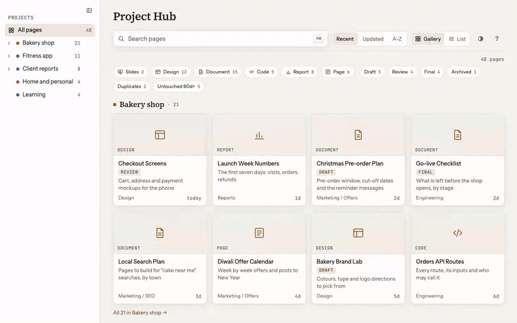
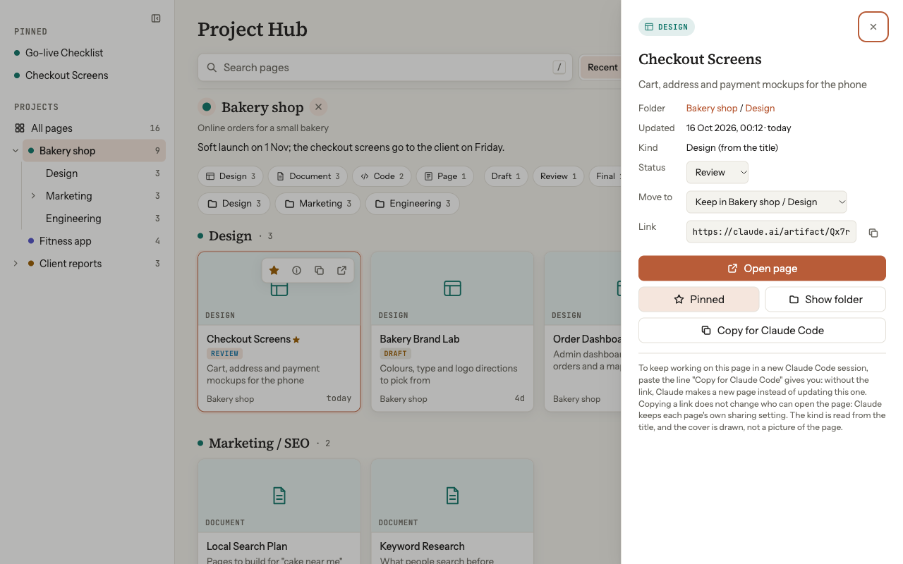
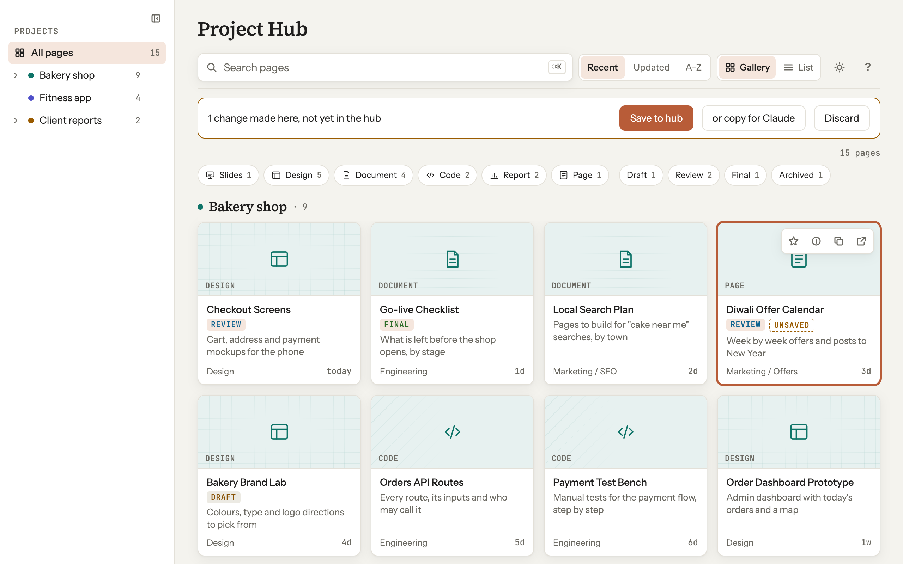
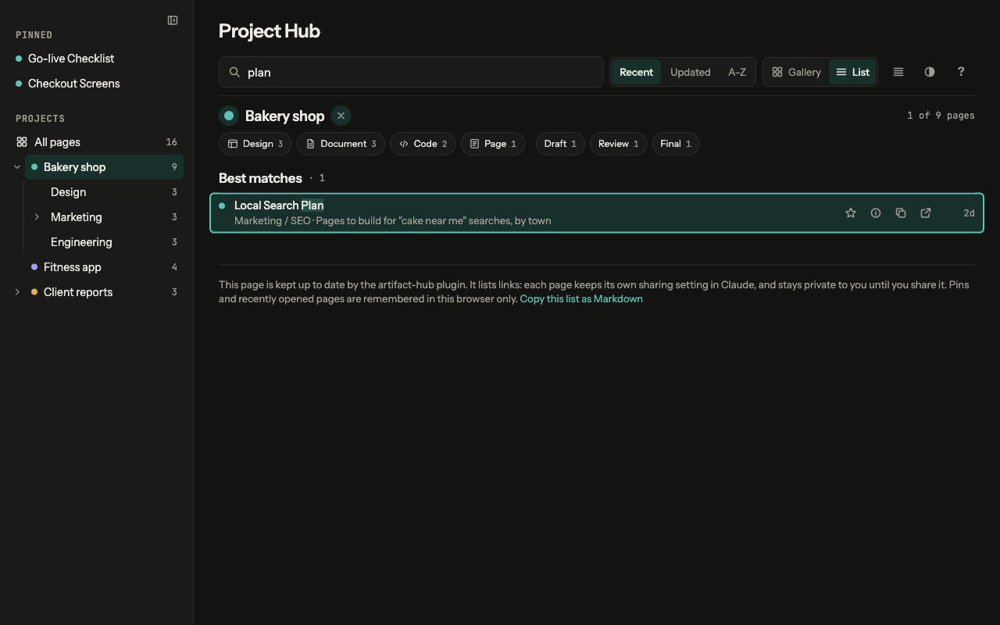
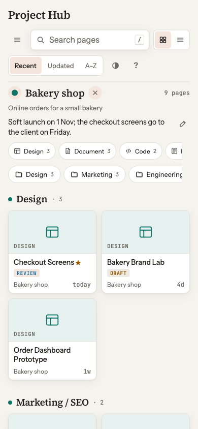
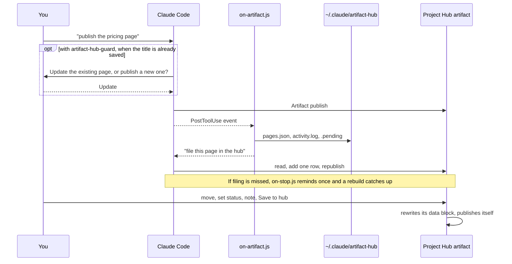

<div align="center">

# Artifact Hub

**Every Claude artifact you publish, filed, searchable, and one keystroke away.**

A Claude Code plugin. Three small hooks save every published link on your machine the moment it exists; five skills file each page into a project folder on one private index page, your Project Hub. Zero dependencies, zero network calls, one HTML file for the page.

[](https://github.com/SureshKumar-24/artifact-hub/actions/workflows/test.yml)
[](https://github.com/SureshKumar-24/artifact-hub/releases/latest)
[](LICENSE)
[](https://github.com/SureshKumar-24/artifact-hub/stargazers)




<sub>Example data in the default look, which matches claude.ai. <a href="https://github.com/SureshKumar-24/artifact-hub/releases/download/v2.1.1/artifact-hub-promo.mp4">Watch the one-minute video</a> (MP4 with narration, 54 seconds, 7.8 MB). A second look (warm paper, teal) is one click away under <code>?</code>. Covers are drawn from each page's kind, never screenshots.</sub>

</div>

## Sixty seconds

```
/plugin marketplace add SureshKumar-24/artifact-hub
/plugin install artifact-hub@artifact-hub
/artifact-hub:setup
```

Setup reads your gallery, proposes projects and folders, and publishes your hub when you agree. From then on, publish as usual: every link is saved and every page is filed.

Optional, on Claude Code 2.1.287 or later: `/plugin install artifact-hub-guard@artifact-hub` adds the [duplicate guard](#optional-the-duplicate-guard-mod), which asks before Claude publishes a page whose title you already have.

## Contents

- [Why](#why)
- [What you get](#what-you-get)
- [A tour](#a-tour)
- [Install](#install)
- [How it works](#how-it-works)
- [Using it](#using-it)
- [Keyboard](#keyboard)
- [Folders and subfolders](#folders-and-subfolders)
- [Data and privacy](#data-and-privacy)
- [Compared with](#compared-with)
- [Questions](#questions)
- [Troubleshooting](#troubleshooting)
- [Optional: the duplicate guard mod](#optional-the-duplicate-guard-mod)
- [Uninstall](#uninstall)
- [Contributing](#contributing)
- [Licence](#licence)

## Why

Claude's artifact gallery is one flat list of recent pages.

| What happens | Where people report it |
|---|---|
| Older pages drop out of view. Without the link, the page is hard to get back. The gallery and the `list` action stop at a date; everything older is invisible until opened by its link. | [anthropics/claude-code#94552](https://github.com/anthropics/claude-code/issues/94552) |
| Nothing separates one project from another. A client report sits next to a study plan. People ask for named groups, set at publish time. | [anthropics/claude-code#102010](https://github.com/anthropics/claude-code/issues/102010) |
| Titles that made sense on the day stop making sense a month later. | [one developer's account](https://dev.to/amsyeung/i-kept-losing-my-claude-artifacts-so-i-made-a-mod-3bph) |
| Without the link, a new Claude Code session publishes a new page instead of updating the old one, so duplicates pile up. | the same thread, and most people's gallery |

Artifact Hub answers each one. The link is saved on your machine at publish time, before anything else happens. Pages are filed into project folders with a plain description each. The details panel, the palette and every folder header hand you the one line that makes a new session update the right page.

## What you get

**On the hub page**

| | |
|---|---|
| **Command palette** | `⌘K` or `Ctrl K`: one box for pages, folders and 42 actions, each action with its key. Nothing typed shows what you opened and ran last; `>` narrows to actions, `#` to folders; `Enter` opens or runs, `Shift+Enter` shows details. |
| **Gallery or list** | Cards with a drawn cover per kind, or a dense list. One switch (`v`), remembered. Same search, folders and sorting in both. On a big hub, All pages shows eight per project with "All 64 in Fixkart →" beneath. |
| **Search** | Titles, descriptions, folders, kinds and statuses at once. Forgives typos, puts a whole-word hit first, highlights what matched. Pick a folder to search inside it. |
| **Filters that never dead-end** | One chip per kind and per status, plus "Duplicates" and "Untouched 60d+" when there is something to show. Each chip counts what it would show under the other filters that are on; a chip that would show nothing is dimmed. |
| **Details** | Everything the hub knows about a page, and nothing it does not: title, description, folder as links, exact time, kind and where it came from, status, the full link. Move it, set its status, pin it, open it. |
| **Save to hub** | Move pages, set statuses, write project notes, then press one button: the page rewrites its own data and publishes a new version of itself inside claude.ai, with your authority. Read-only views get the older path: one message to paste into Claude Code. |
| **Pinned, Continue working, Since you were here** | Pins and recently opened pages at the top; "8 pages updated since your last visit" with a chip to show just those. Kept in your browser only. |
| **Project notes** | One short line per project of what matters now, under its heading, editable on the page. |
| **Shared with you** | Pages other people shared with you sit under "Shared with me" with the owner's name. Listed, filed and marked like any other; never offered for republishing, because only the owner can. |
| **Export** | Copy or download the whole hub as JSON or Markdown. Made in the browser, sent nowhere. |
| **Two looks, both themes** | The default matches claude.ai (cream, charcoal, terracotta, serif headings); the hub's own look is warm paper and teal. Light, dark, or follow the system. Phone, tablet and desktop layouts, every control at touch size on touch screens. |

**In Claude Code**

| | |
|---|---|
| **Every link is kept** | At publish time the plugin writes the link, title, time, type and project folder to a plain file on your machine. This does not depend on Claude remembering. |
| **Filed where you work** | A page published from a repository you linked to a project lands in that project; otherwise words in the title decide; otherwise "Other", and Claude tells you so you can correct it once. |
| **Keep working on a page** | "Copy for Claude Code" (one page) and "Copy this project for Claude Code" (every page of a project, newest first) give a new session the links, so it updates pages instead of publishing duplicates. At session start, Claude is also told the last two pages published from the repository you are in. |
| **Replaced pages** | Publish a page again from a session that lost the link and the hub keeps one row, pointing at the new page. The old link still opens. |
| **Duplicate guard** (optional mod) | Before Claude publishes a new page whose title your saved list already has, one question: update the existing page, or publish a new one. "Update" republishes at the same link, so nothing breaks for anyone who has it. |
| **Find by asking** | "Where is my pricing page?" or `/artifact-hub:find pricing` answers with the folder and link, and offers to open the page so your next publish updates it. |
| **Weekly digest** | `/artifact-hub:week`: what you published this week by project, what has sat untouched for 60 days, likely duplicates, pages shared with you. From the files on your machine. |
| **Link check** | Ask "check my links": each page is read once; a page that no longer opens is marked gone, never removed. |
| **Claude Docs too** | A document made with the Claude Docs connector is saved and filed like a page. |
| **Kinds Claude knows** | A page made from one of Claude's artifact types (Docs, Slides, Design, Design system, Dashboard, and Motion where the plan has it) keeps that kind, with its own cover and chip. Other pages get a kind from the title, and the panel says which. |

**Under the hood**

| | |
|---|---|
| **Three hooks** | `PostToolUse` saves the link and asks Claude to file the page. `Stop` reminds once if a page published that turn was not filed. `SessionStart` names the last two pages from this repository. Plain Node.js in exec form, no shell in between. |
| **Five skills** | `setup`, `hub` (rebuild and filing), `find`, `week`, `pin`. Plain instructions; Claude uses its own Artifact tool. |
| **One page** | `skills/hub/template.html`: HTML, CSS and vanilla JavaScript, 2,000 lines, no libraries, no fetches except the page reading its own source to save. |
| **Tests** | `node --test test/`: the hooks in a fresh temporary home and the page's invariants, run on Linux, macOS and Windows for every change. |

## A tour


<sub>The gallery at desktop width. Every card is a link; hover or focus shows pin, details, copy and open.</sub>


<sub><b>⌘K</b> finds pages, folders and actions in one box. The footer teaches the keys; the palette remembers what you opened and ran last.</sub>

<table>
<tr>
<td width="50%"></td>
<td width="50%"></td>
</tr>
<tr>
<td><b>Details</b>: what the hub knows about a page and nothing it does not. Status and folder are menus with a filter box when the list is long; the kind says whether Claude recorded it or the title suggested it.</td>
<td><b>Save to hub</b>: changes show at once, marked Unsaved. One button publishes a new version of the page itself. Nothing diverges, because Claude reads the same data next time.</td>
</tr>
<tr>
<td></td>
<td></td>
</tr>
<tr>
<td><b>Search, list, dark</b>: one box searches titles, descriptions and folders inside the folder you are in, forgives typos and highlights the match.</td>
<td><b>Phone</b>: one search row, one strip that scrolls sideways, chips that scroll instead of stacking, and every control at 40 px on a touch screen. The palette has its own button there.</td>
</tr>
</table>

## Install

**From this repository.** In Claude Code, or the same two commands as `claude plugin marketplace add …` and `claude plugin install …` in a terminal:

```
/plugin marketplace add SureshKumar-24/artifact-hub
/plugin install artifact-hub@artifact-hub
```

Then once:

```
/artifact-hub:setup
```

**From Anthropic's community marketplace**, once listed there:

```
/plugin marketplace add anthropics/claude-plugins-community
/plugin install artifact-hub@claude-community
```

**Skills only**, into any agent that reads `SKILL.md` files:

```
npx skills add SureshKumar-24/artifact-hub
```

That gives you the `hub`, `find` and `pin` skills against a hub you already have, but not the hooks that save each link at publish time, so the saved list, the weekly digest and first-time setup need the plugin install.

| You want to | Do this |
|---|---|
| Install a fixed, reviewed version | Add the tag to the first command, for example `#v2.1.1` |
| Try it without installing | `claude --plugin-dir path/to/artifact-hub` |
| Read the code first | Three short scripts, five instruction files and one page template; see [SECURITY.md](SECURITY.md) and [docs/ARCHITECTURE.md](docs/ARCHITECTURE.md) |

**Needs:** Claude Code on a plan that can publish artifacts, and Node.js on your PATH.

## How it works



Two layers, on purpose:

1. **The script** saves the link to `pages.json`. This always happens, in the same turn, before Claude says a word.
2. **Claude** adds the page to your hub after a short reminder. If that step is ever missed, the `Stop` hook reminds it once at the end of the turn; if the session is cut short, the link is still on disk, and `/artifact-hub:hub` puts it on the hub.

Edits you make on the page are the third path: the page saves itself through the claude.ai runtime's `artifact` capability, and Claude reads that data on its next rebuild, so there is one source of truth with two writers who never overwrite each other.

## Using it

| When | What you do | What happens |
|---|---|---|
| Once | `/artifact-hub:setup` | Claude reads your gallery (the 200 most recently updated) and the saved list, proposes projects and folders, and publishes your hub when you agree. |
| Every publish | Nothing | The link is saved and the page is filed on your hub. |
| You delete a page | Nothing | Its row is taken off the hub. |
| You cannot find a page | Ask: "where is my pricing page?" or `/artifact-hub:find pricing` | The title, folder and link, and an offer to open the page so your next publish updates it. |
| You publish a page again from a new session | Nothing | The hub keeps one row, pointing at the new page; the old link still opens. |
| You start a new session on a project | On the hub, open the project and press its copy button, or `⌘K` "Copy this project for Claude Code"; paste into Claude Code | Claude has every page of the project with its link, so it updates pages instead of publishing duplicates. |
| You want to reorganise | Do it on the page (Move to, Status, notes) and press **Save to hub**; or ask "move the SEO pages into Shop / Marketing" | The page saves itself; asked in words, Claude moves them and remembers the rule. |
| Any time | `/artifact-hub:hub` | Rebuilds the hub from the gallery and the saved list. Adds what is new, never removes what is there. |
| Once a week | `/artifact-hub:week` | A short digest: published this week, untouched for 60 days, likely duplicates, shared with you. |
| You want it one click away | `/artifact-hub:pin` | Pins the hub to your sidebar; unpins on request. |
| You want your data out | On the hub: Copy or Download as JSON or Markdown | Every project, page, link, date, kind and status. |
| You suspect dead links | Ask: "check my links" | Each page is read once; a page that no longer opens is marked gone, never removed. Slow, so Claude asks first past 40 pages. |

## Keyboard

| Key | Does |
|---|---|
| `⌘K` or `Ctrl K` | Command palette: pages, folders and actions (`>` actions only, `#` folders only) |
| `/` | Search |
| `j` `k` or `↑` `↓` | Move between pages (the gallery in reading order) |
| `Enter` | Open the page in a new tab |
| `i` | Details of the page |
| `c` | Copy the page link |
| `p` | Pin or unpin the page |
| `x` | Select the page (shift-click does the same) |
| `v` | Gallery or list |
| `o` then `1`–`9` | Open the page wearing that digit (the first nine shown) |
| `[` | Hide or show the sidebar |
| `?` | All shortcuts, and the look switch |
| `Esc` | Close what is open, clear the selection; in the search box, clear it, then leave it |

Every button that has a key shows it in its tooltip on a pointer device.

## Folders and subfolders

A project is a top-level folder. Inside it you can have folders within folders:

```
All folders
├── Bakery shop
│   ├── Design
│   └── Marketing
│       ├── Offers
│       └── SEO
├── Fitness app
└── Client reports
    └── 2026
```

You manage them in plain words:

| Say | Result |
|---|---|
| "make a folder Reports inside Shop" | A new subfolder |
| "move the SEO pages into Shop / Marketing" | Pages moved, rule saved for new pages |
| "rename Marketing to Growth" | Folder renamed, pages kept |
| "remove the Offers folder" | Its pages move up to the parent folder |
| "this folder belongs to the Shop project" | Pages published from that repository go to Shop from now on |

How a new page finds its place: the repository you are working in, if you linked it to a project; else words in the title, matched against each project's and subfolder's rules; else **Other**, and Claude tells you. No row is ever deleted by a move, a rename or a rebuild.

## Data and privacy

A plugin can run code on your machine, so here is all of it.

| | |
|---|---|
| **Runs** | `hooks/on-artifact.js` (under 200 lines) on `PostToolUse` for the `Artifact` tool and the Claude Docs connector's `batch` call when it creates a document. `hooks/on-stop.js` (under 40 lines) on `Stop`. `hooks/on-session.js` (under 60 lines) on `SessionStart` (startup, resume, clear, compact, fork). Node.js in exec form; no shell, no dependency, no MCP server, no agent. |
| **Reads** | The hook event on stdin, the first 8 KB of the file just published (for its `<title>`) or the new document's name, Claude's last message of the turn, and `hub.json`. During setup or a rebuild, Claude reads your own artifact list through its Artifact tool. |
| **Writes** | In `~/.claude/artifact-hub/`: `pages.json` (your published links), `hub.json` (your hub's address and folder rules), `activity.log` (one line per publish and filing, the 500 latest), and two markers: `.pending` between a publish and its filing, `.offered` so setup is suggested at most once a day. And your hub artifact, through Claude's Artifact tool. |
| **Sends** | Nothing. No network request, no server, no analytics, no account. |
| **The page** | Declares two claude.ai runtime capabilities: `artifact`, so Save to hub can publish a new version of the page from inside the viewer, and `downloads`, so an export can be saved as a file after you confirm. Both act as you, inside claude.ai; the viewer's content-security policy blocks any other host. Pins, recents, hidden folders, colours and unsaved edits live in your browser's storage and never leave it. |

The hub is a private artifact in your account. Copying a link does not change who can open that page. Covers are drawn, not screenshots: the hub holds a title, a description, a date and a link per page, never the page itself. Check it yourself in a minute: [SECURITY.md](SECURITY.md).

What it costs in context: one line of about 40 words at session start, only in a repository you published from in the last 30 days; one reminder of about 80 words in a turn where Claude publishes or deletes an artifact; filing a page is one read and one republish of the hub.

## Compared with

| | Doing nothing | A hand-kept index page | artifact-catalog | Artifact Hub |
|---|---|---|---|---|
| Older pages | Lost once the gallery stops listing them | Kept, if you remembered to add them | Added when you say yes to a prompt | Saved on disk at publish time, no question asked |
| Groups | None | Whatever you type | Flat categories, chosen by Claude | Folders and subfolders, filed by the repository you are in, rules remembered |
| Republished pages | A duplicate | A stale row | Ignored | One row, pointing at the new page |
| Finding a page | Scroll | Search the page | Notion, optionally | Palette, search with typos, kinds, statuses, `find` skill |
| Edits | n/a | Edit HTML | Notion | On the page, saved by the page |
| Titles in the gallery | As published | As published | Renamed with a category prefix | As published |
| Needs | nothing | time | a Claude Code build with hook modules, optional Notion | Claude Code and Node.js |

[artifact-catalog](https://github.com/amsyeung/artifact-catalog) is the other plugin that takes this problem seriously; its Add/Skip prompt and its database-backed index are good ideas. Artifact Hub makes different bets: no prompt, no rename, no third service, and a page you can keep when you leave.

## Questions

<details>
<summary><b>Can other people see my hub?</b></summary>

No. It is private to you, like any artifact, unless you share it yourself. Each page it links to keeps its own sharing setting.
</details>

<details>
<summary><b>What happens when I move a page or change a status on the hub?</b></summary>

It changes at once in your browser and is marked Unsaved. The bar at the top offers **Save to hub**: the page reads its own source, rewrites the data block from what it holds, and publishes a new version of itself with your account's authority; every open view reloads and the marker goes away. If the view cannot write (a read-only share, an old viewer, a local copy), the bar offers "copy for Claude" instead: one message listing each change, to paste into Claude Code. "Discard" forgets the changes.
</details>

<details>
<summary><b>Will a rebuild delete rows?</b></summary>

No. A page missing from the gallery listing is treated as old, not deleted. A row is removed only when you delete the artifact or say the page is gone. Rebuilds always read the hub first, so an edit you saved on the page is never overwritten.
</details>

<details>
<summary><b>Why is the cover a symbol and not a picture of the page?</b></summary>

Because the hub never reads your pages. It knows each page's title, description, date and link, nothing more, and it says so in the details panel. A faint pattern per kind (lines for a document, bars for a report, a grid for a design) keeps the cards of one project apart.
</details>

<details>
<summary><b>Gallery or list?</b></summary>

The gallery is the default on a wide screen: covers and two lines of description make similar pages easier to tell apart. The list is the default on phones and tablets and the faster scan when you know the title. `v` switches; both show the same pages in the same order.
</details>

<details>
<summary><b>Does it work for a team?</b></summary>

Each person has their own hub, and it can hold the team's pages too: pages shared with you go under "Shared with me" with the owner's name. Those rows can be filed and marked, but the hub never offers to republish them, because only the owner can.
</details>

<details>
<summary><b>What kinds of pages does it know?</b></summary>

The kinds Claude records itself: Docs, Slides, Design, Design system, Dashboard and Motion, taken from the type a page was made from. For a plain page the kind is read from the title (Document, Report, Code, Design, Slides, Motion, or Page) and the panel says so.
</details>

<details>
<summary><b>Can I edit the saved list by hand?</b></summary>

Yes. `~/.claude/artifact-hub/pages.json` is plain JSON: one entry per page with `url`, `title`, `folder`, `first`, `last`, and when they apply `type`, `typeId`, `replacedBy`, `deleted`.
</details>

<details>
<summary><b>What if I want only the saved list, no hub?</b></summary>

Install and skip setup. Every published link is still saved. You will see one mention of setup per day at most, and only in a turn where you publish.
</details>

<details>
<summary><b>Is this made by Anthropic?</b></summary>

No. It is an independent open-source plugin.
</details>

## Troubleshooting

| Symptom | Try |
|---|---|
| A page is not on the hub | `/artifact-hub:hub` |
| A page went to the wrong folder | Tell Claude where it belongs; the rule is saved |
| Nothing happens after a publish | `node --version` in a terminal; the plugin enabled in `/plugin`; a new session after an update |
| Save to hub is missing from the bar | The hub was published before 1.7.0 or without the capability: run `/artifact-hub:hub` once and it is republished with it. A read-only share never shows it. |
| The hub still has an old layout | `/artifact-hub:hub` once; it moves the hub to the current page and keeps every row, pin and folder link |
| The plugin seems old after an update | `claude plugin update artifact-hub`, then a new session; check the version in `claude plugin list` |
| A second hub appeared | Tell Claude which one to keep; delete the other from the gallery |

Anything else: [open an issue](https://github.com/SureshKumar-24/artifact-hub/issues/new/choose).

## Optional: the duplicate guard mod

**The problem it removes.** A session without a page's link publishes a new page. Before the guard, the plugin could only react: mark the old entry as replaced and point the hub row at the new page. You still ended with two live pages, and the link you had sent people went stale.

**What it does instead.** Claude Code 2.1.287 added mods: plugins whose hooks are TypeScript functions that run inside the engine and can rewrite a tool call before it happens. `artifact-hub-guard` uses that for the one thing a classic hook cannot do: when Claude is about to publish a **new** page (an `Artifact` call with no `url`) whose title is already in your saved list, you get one question, right in Claude Code:

> A page titled "Pricing Page" already exists in shop, last published 2026-10-10. Update it instead of publishing a new one?
>
> Update the existing page · Publish a new page anyway

"Update" rewrites the call with the saved link, so the page gets a new version at the same address and everyone who has the link sees the update. "Publish anyway" lets the call through. The guard never blocks: a failure, a non-interactive run or a dismissed prompt all let Claude's call through as it was. It reads `pages.json` only, writes nothing, sends nothing, and ignores republishes that already carry a link, reads, lists, deletes and uploads.

```
/plugin install artifact-hub-guard@artifact-hub
```

It is a separate plugin on purpose. Anthropic's mods README says hooks modules load only where function hooks are enabled and that the API may change between releases without notice; the main plugin keeps working on every Claude Code with classic hooks, and the guard adds itself where mods run. Details, what it reads and how to test it: [guard/README.md](guard/README.md).

## Uninstall

`/plugin uninstall artifact-hub` (and `/plugin uninstall artifact-hub-guard` if you installed the guard), then delete `~/.claude/artifact-hub/` if you no longer want the saved list. Your hub artifact stays until you delete it yourself.

## Contributing

Issues and pull requests are welcome. Start with [CONTRIBUTING.md](CONTRIBUTING.md) for setup and the UX bar, and [docs/ARCHITECTURE.md](docs/ARCHITECTURE.md) for how the pieces fit. The whole plugin is small:

```
.claude-plugin/   plugin and marketplace manifests
hooks/            hooks.json, on-artifact.js, on-stop.js, on-session.js (the only code that runs)
skills/hub/       rebuild, filing, folders; template.html is the hub page
skills/find/      find a page by a few words and hand its link to the session
skills/week/      the weekly digest
skills/pin/       pin or unpin the hub
skills/setup/     first-time setup
docs/             screenshots and ARCHITECTURE.md
test/             node --test test/
guard/            the optional duplicate guard mod, a second plugin in the same marketplace
```

Changes are listed in [CHANGELOG.md](CHANGELOG.md).

## Licence

MIT, by Suresh Kumar. Not made by or affiliated with Anthropic.
